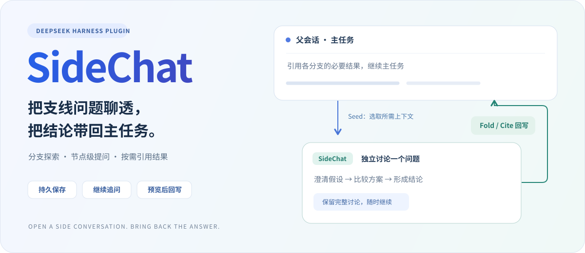
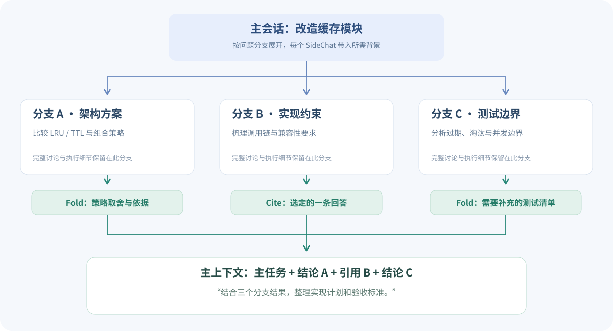
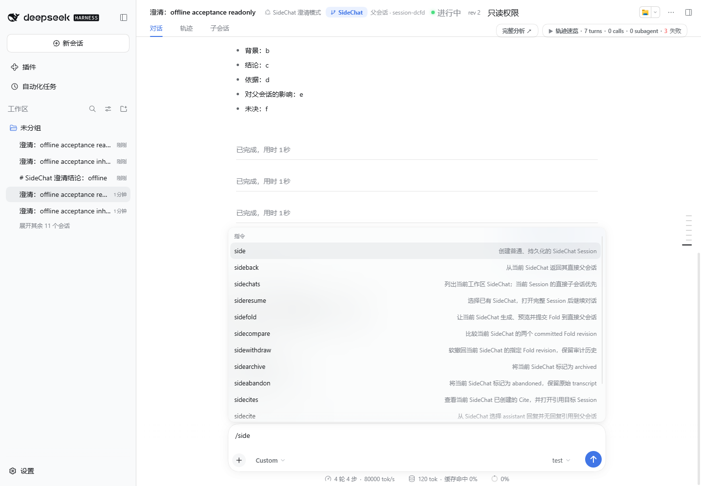
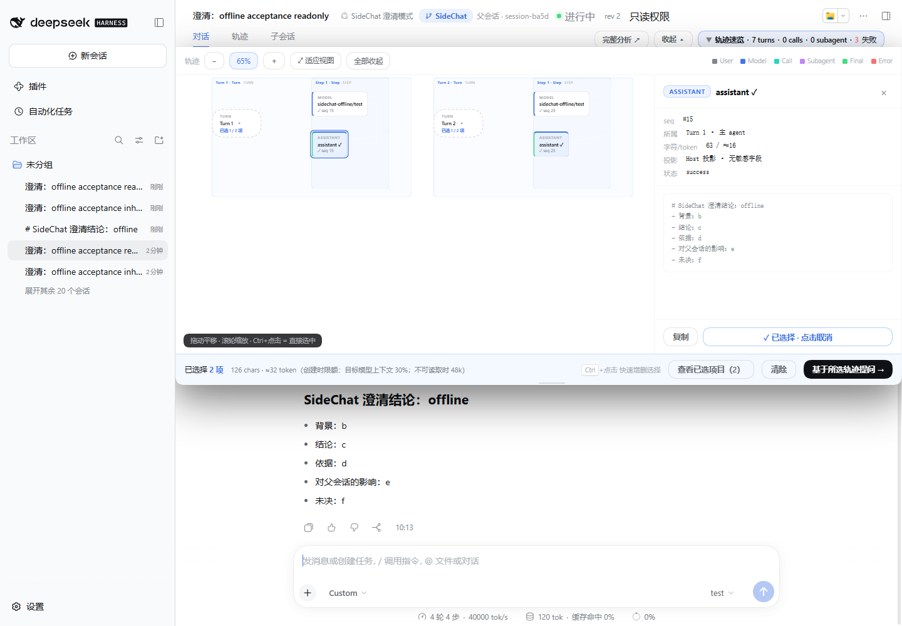
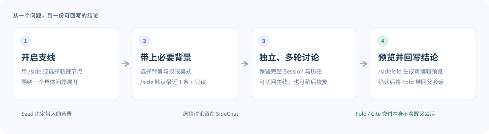

# DeepSeek Harness SideChat

**把支线问题聊透，把结论带回主任务。**

为 DeepSeek Harness Web 提供独立、持久化、可恢复的 SideChat 会话。讨论可以围绕不同问题分支展开，也可以从执行轨迹中的具体节点继续追问，再通过 Fold 回写结论，或用 Cite 引用一条回答。

**各分支保留完整探索过程，主会话只按需引入选定结果。** 你可以在主会话中结合多个分支的发现继续讨论，减少无关过程对上下文的占用，让主会话保持聚焦、简洁。



`插件 v0.3.4` · `DSH 0.2.1-alpha.2` · `Web Client` · `MIT`

[多分支结果引用](#多个分支分别探索主会话按需引用结果) · [轨迹与节点提问](#从轨迹中的节点继续提问) · [快速开始](#快速开始) · [命令速查](#命令速查) · [开发与验证](#开发与验证)

## 什么情况下用 SideChat？

主任务进行到一半，经常会遇到值得单独讨论的问题：一个设计取舍、一段不熟悉的代码，或一条需要先核实的假设。SideChat 让这些问题拥有自己的会话和上下文。你可以分开探索、沿某个执行节点追问，再把选定结果组合回主线，支持更灵活的非线性对话方式。

| 场景 | 在 SideChat 中做什么 | 带回主线什么 |
|---|---|---|
| 汇总多个分支结果 | 不同分支分别研究方案、实现约束和测试边界 | 选定结论与回答，供主会话进一步综合讨论 |
| 围绕执行节点提问 | 在轨迹图中选择一次调用、结果或相关节点，提出新问题 | 针对具体过程的解释、判断或下一步建议 |
| 比较设计方案 | 围绕约束比较方案 A / B，澄清取舍 | 决策、依据与未决项 |
| 理解现有实现 | 选取相关文本或轨迹项目，继续追问 | 实现要点与精确引用 |
| 核对风险与假设 | 单独检查权限、兼容性或边界条件 | 对主任务的影响和建议 |
| 暂存一条讨论 | 保留会话，稍后用 `/sideresume` 继续 | 经过补充和修订的结论 |

每个 SideChat 都是普通 DSH Session，拥有完整会话页面、原生模型选择器和持久化历史。父子关系、Seed 来源、权限快照及 Fold revision 由插件单独保存。

## 多个分支分别探索，主会话按需引用结果

例如，你在主会话中推进“改造缓存模块”，把三个不同问题分别交给 SideChat：



*工作方式示意；结果由你逐次选择并引入主会话。*

| 分支 | 独立完成的工作 | 主会话需要的内容 |
|---|---|---|
| A：架构方案 | 比较 LRU、TTL 及组合策略 | 一份策略取舍与决策依据 |
| B：实现约束 | 梳理现有调用链与接口约束 | 一条明确说明兼容性要求的回答 |
| C：测试边界 | 分析过期、淘汰、并发访问等边界 | 一份需要补充的测试清单 |

主会话只引入 **A 的结论、B 的指定回答和 C 的结论**，完整推演、工具输出与中间尝试继续留在各自分支。随后，你可以在主会话中继续问：

> 结合三个分支的结果，整理最终实现计划；如果策略选择与接口约束冲突，请指出冲突，并把测试清单转为验收标准。

具体操作：

1. 从同一主会话创建多个 SideChat，分别讨论不同问题。
2. 对需要归纳的分支使用 `/sidefold`，预览并编辑要带回主会话的结论。
3. 在主会话使用 `/sidecite`，选择一个直接子分支，再选择一条具体回答；重复操作即可引入其他分支结果。
4. 引用完成后，在主会话主动发送综合问题，基于这些必要内容继续对话。

这样，主上下文新增的是你选择的结果及来源信息，而不是所有分支的完整 transcript。需要核对证据时，可回到原分支；Fold 附带精确消息指针时，也可按需读取对应内容。

同一父会话的直接子分支可用上述方式引用。如果结果来自同工作区中**其他父会话**的 SideChat，需要显式使用 `/sidecite-cross`，并由 Host 开启 `allowCrossParentCite`；该能力默认关闭。

## 界面预览



*实际 alpha.2 Web 截图，来自 2026-10-13 的本地离线验收。示例回答由受控测试适配器生成；轨迹中的失败来自权限故障注入测试。*

在一个页面中，你可以看到：

- **会话身份**：SideChat 标记、父会话入口、状态、revision 与权限模式。
- **完整讨论**：继续多轮对话，并通过“对话 / 轨迹 / 子会话”切换视图。
- **轨迹速览**：按 Turn / Step 查看执行过程，选择相关项目作为后续提问的背景。
- **命令菜单**：输入 `/side` 即可找到创建、返回、恢复、Fold、Cite 等操作及说明。

## 从轨迹中的节点继续提问

轨迹可视化把会话执行过程组织为 **Turn / Step 和事件节点**，展示用户输入、模型请求、工具调用及结果、最终回答等已投影内容。你可以查看具体节点，再选择与问题相关的背景发起 SideChat。



*实际 alpha.2 Web 截图，摄于 2026-10-14 的本地离线受控环境；图中的跨轮次节点选择、详情查看与“基于所选轨迹提问”入口为真实交互。*

1. 点击会话页的 **“轨迹速览” / “完整分析”**，或输入 `/traceask` 打开轨迹图。
2. 展开相关 Turn，点击节点查看详情；图中支持拖动平移和滚轮缩放。
3. 用 **Ctrl+点击** 增删可选节点，或在详情中点击 **“选择此项”**。可以组合不同轮次中相关的节点。
4. 在 **“已选项目”** 中查看、定位或移除选择，核对背景内容与估算 token 数。
5. 点击 **“基于所选轨迹提问 →”**，选择权限并输入自己的问题，创建带有这些节点背景的新 SideChat。

问题由你决定，例如：

| 选择的背景 | 可以继续问什么 |
|---|---|
| 一次工具调用及结果 | “这次查询说明了什么？还有哪些条件没有验证？” |
| 不同轮次中的相关回答 | “这两次判断为什么不同？各自依赖什么假设？” |
| 一条错误及相关执行节点 | “问题出在哪个环节？下一步应该检查哪里？” |
| 一份已回写的 Fold 结论 | “如果约束发生变化，这份结论还成立吗？” |

你选择的是**与问题有关的节点背景**，不必把此前全部执行过程复制进新会话。选择仍受 Host 校验、节点可选状态和上下文预算约束。

## 快速开始

### 1. 准备环境

| 依赖 | 要求 |
|---|---|
| DeepSeek Harness | **`0.2.1-alpha.2`**，本插件精确适配的版本 |
| Node.js | `^22.19.0` 或 `>=24.0.0` |
| pnpm | `>=10.0.0 <12.0.0`，用于源码构建 |
| 使用界面 | DSH 的 `web` profile |
| 模型 | 在 DSH 中配置可用模型，用于对话与 Fold 生成 |

本次适配固定在上游提交 `d743267388641bc76f17c45ce8b4c231aed1d32c`。其他 DSH 版本需重新核验兼容性。

### 2. 构建并安装

克隆或下载本仓库，在仓库根目录执行：

```powershell
pnpm install --frozen-lockfile
pnpm verify
npm pack
```

已经安装 `dsh` CLI 时，将生成的 tarball 安装到 Web profile：

```powershell
dsh plugin --profile web add .\dsh-sidechat-plugin-0.3.4.tgz --force
dsh --profile web
```

如果从 DSH 源码运行，在 **DSH 源码根目录**执行以下命令，并替换示例 tarball 路径：

```powershell
$sidechatPackage = 'D:\path\to\dsh-sidechat-plugin-0.3.4.tgz'
pnpm dsh plugin --profile web add $sidechatPackage --force
pnpm dsh --profile web
```

### 3. 创建第一个 SideChat

在父会话输入 `/side`，选择 Seed 和权限模式，再输入一个具体问题。例如：

> 为这个缓存模块比较 LRU 和 TTL 两种方案，重点说明失效策略、内存上限和测试成本。

默认使用 **最近 1 条直接文本**作为背景，并推荐 **只读模式**。创建后自动进入新的 SideChat 页面。

安装检查：父会话中能找到“子会话”视图，输入 `/side` 能看到命令说明，并能实际创建 SideChat。仅看到首页正常加载或 preset 列表中存在 `sidechat-clarifier`，不足以证明完整功能可用。

## 使用流程



1. **创建**：在父会话输入 `/side`，依次选择上下文、权限并提出问题。
2. **讨论**：在 SideChat 中继续追问；`/sideback` 随时返回直接父会话。
3. **生成**：输入 `/sidefold`，选择完整或增量 Fold，生成可编辑预览。
4. **确认**：检查并编辑结论后提交；成功后自动返回父会话。

包含确认与取消的插件对话框使用 **Enter 确认、Esc 取消**；文本框用 **Shift+Enter 换行**。

### Fold 和 Cite，怎么选？

| 方式 | 适合什么情况 | 如何使用 |
|---|---|---|
| **Fold：回写结论** | 一轮讨论已经形成决策，需要归纳背景、依据和影响 | `/sidefold` → 生成 → 预览编辑 → 提交 |
| **Cite：引用回答** | 某条 assistant 回答本身已经足够清晰，希望保留原文 | `/sidecite` → 选择回答 → 引用到父会话 |

Fold 的固定结构如下，内容为示例：

```markdown
# SideChat 澄清结论：缓存策略选择

- 背景：缓存需要限制内存占用，并允许短时间的数据延迟。
- 结论：采用容量受限的 LRU，配合 TTL 处理过期数据。
- 依据：两者分别约束空间和数据新鲜度，职责清晰。
- 对父会话的影响：实现容量淘汰与过期检查，并补充边界测试。
- 未决：根据实际访问模式确定容量和 TTL。
```

Fold 支持完整版本、增量版本、revision 对比和软撤回。预览生成后若子会话继续讨论，旧预览会被视为过期，避免把新增内容误当成已经总结过的上下文。

**Fold / Cite 的交付本身不会触发父会话回复。** Fold 在追加后预计达到上下文阈值时，会先压缩父会话旧历史；该压缩可能产生独立模型调用。

## 命令速查

| 目的 | 命令 | 作用 |
|---|---|---|
| 轨迹提问 | `/traceask` | 打开轨迹可视化，选择节点作为 SideChat 提问背景 |
| 创建 | `/side`、`/btw` | 创建持久化 SideChat，默认 Seed 为 `tail:1` |
| 查找 | `/sidechats` | 列出当前工作区 SideChat，直接子会话优先 |
| 继续 | `/sideresume` | 打开已有 SideChat，继续原讨论 |
| 返回 | `/sideback` | 返回当前 SideChat 的直接父会话 |
| 总结 | `/sidefold` | 生成、预览、编辑并提交 Fold |
| 引用 | `/sidecite` | 在子会话中引用回答到父会话，或在父会话中选择直接子分支的回答 |
| 比较 | `/sidecompare` | 比较两个已提交的 Fold revision |
| 撤回 | `/sidewithdraw` | 软撤回指定 revision，保留审计历史 |
| 用量 | `/sideusage` | 查看子会话、父会话增量及额外 Seed 调用的 token 用量 |
| 归档 / 恢复 | `/sidearchive`、`/siderestore` | 归档会话或恢复已归档会话 |
| 放弃 | `/sideabandon` | 标记为放弃，保留 Session 与历史 |
| 引用记录 | `/sidecites` | 查看 Cite 记录并打开目标会话 |
| 跨父引用 | `/sidecite-cross` | 显式引用同工作区其他 SideChat 的回答；默认关闭 |

## 权限与上下文

### Seed：带多少背景，由你选择

Seed 是创建 SideChat 时冻结的初始背景，保存文本与来源，供后续追溯。文本类 Seed 只取直接文本；轨迹选择可另外携带用户明确选中的执行项目。插件不会把完整父会话历史自动复制到子会话。

| 选择 | Seed | 适用场景 |
|---|---|---|
| 最近文本 | `tail:1`、`tail:2`、`tail:4` | 刚提出的问题或最近几条回答；默认 `tail:1` |
| 空白背景 | `none` | 一个可以独立说明的新问题 |
| 精确选择 | `pick:1`、`pick:many`、`turn`、`selection` | 指定消息、某一轮或消息中的字符区间 |
| 任务式背景 | `task` | 根据选取的近期文本生成简短任务背景 |
| 摘要背景 | `summary` | 对明确选择的消息生成有预算的摘要 |
| 执行轨迹 | 轨迹速览中的选择入口 | 从相关执行项目或正式 Fold 结论继续提问 |

`task` 与 `summary` 各需要额外模型调用。`task` 生成不唤醒、不推进父会话。轨迹背景默认预算为目标模型上下文的 **30%**，容量不可得时回退至 **48,000 estimated tokens**。

### 两种权限模式

| 模式 | 行为 |
|---|---|
| **只读（推荐）** | 使用父会话可见工具与只读候选能力的交集；沙箱为 `read-only`，审批为 `never` |
| **继承** | 继承父会话创建时的 Agent preset、有效沙箱、审批策略及可见工具上限 |

权限上限由 Host 计算并保存，冷恢复时重新安装。安装失败时，后续模型步骤会被阻断；缺少权限快照的旧记录会保留并拒绝模型准入。PTC 的 `run_code` 传输可在有效快照下使用，嵌套工具仍逐调用受权限上限约束。

## 开发与验证

```powershell
pnpm build               # 构建 Host / Client bundle 与类型声明
pnpm test                # 运行 Unit、Host、Client 测试
pnpm verify              # 完整检查、真实 DSH 类型门槛、构建与 manifest 检查
npm pack                 # 生成安装包；prepack 会重新构建并检查 manifest
```

源码构建不要求相邻目录存在 DSH checkout。`types/dsh-compat.d.ts` 支持独立构建；真实 alpha.2 Host / Client 类型检查通过 `tests/contracts/alpha2-fixture` 执行。

**最近一次适配验收：2026-10-13。** 完整验证链通过 **28 个测试文件 / 241 项测试**；另已验证真实隔离 Host RPC、冷重启、AgentLoop 权限故障恢复，以及 Chrome 页面与命令菜单。模型输出使用离线受控适配器。证据及未覆盖项见[实施报告](docs/DSH_0.2_IMPLEMENTATION_REPORT.md)。

<details>
<summary>配置项与项目结构</summary>

默认配置见 [`cordis.patch.yml`](cordis.patch.yml)。

| 配置 | 默认值 | 用途 |
|---|---:|---|
| `foldMaxTokens` | `500` | Fold 输出预算 |
| `foldAppendThresholdRatio` | `0.8` | 父上下文达到该比例时，先压缩再重新测量 |
| `trajectoryContextWindowRatio` | `0.3` | 轨迹背景占目标模型上下文的比例 |
| `trajectoryFallbackMaxTokens` | `48000` | 模型容量不可得时的轨迹背景估算上限 |
| `citeMaxTokens` | `500` | Cite 文本预算 |
| `readMaxMessages` / `readMaxChars` | `5` / `20000` | 一次精确 Recall 的消息数 / 字符数上限 |
| `seedSummaryMaxTokens` / `seedTaskMaxTokens` | `500` / `500` | 摘要式 / 任务式 Seed 的输出预算 |
| `allowCrossParentCite` | `false` | 同工作区显式跨父 Cite |
| `preset` | `sidechat-clarifier` | 只读 SideChat preset |

```text
src/                    Host、Client 与共享业务源码
cordis.patch.yml        声明式 preset、Host 服务与依赖装配
types/                  独立构建使用的公共接口声明
tests/                  业务测试与真实 alpha.2 类型 fixture
scripts/                构建、契约、可移植性及 manifest 检查
docs/                   图示、适配文档与验收清单
lib/                    构建产物：index.js、client.js、types/
```

有 DSH 源码时，可额外核验契约锚点：

```powershell
$env:DSH_SOURCE_DIR = '<dsh-source-path>'
pnpm verify:contracts
```

</details>

## 更新、卸载与常见问题

**如何更新？** 更新源码后重新执行构建与打包命令，用 `dsh plugin --profile web add <tarball-path> --force` 安装，再重启 DSH。浏览器仍显示旧页面时使用 `Ctrl+F5` 刷新。

**如何卸载？**

```powershell
dsh plugin --profile web remove dsh-sidechat-plugin
```

已创建的普通 Session 和 transcript 会保留；插件提供的 UI、关系展示及回写功能随插件卸载而移除。

**归档会删除历史吗？** `/sidearchive` 与 `/sideabandon` 只改变插件组织状态，保留原始讨论。父会话不存在时，SideChat 可继续读取，但不能向已不存在的父会话 Fold 或 Cite。

**为什么用量显示不可得？** `/sideusage` 只把可验证的 provider usage 当作精确用量；证据不完整时显示不可得或不完整，压缩替换副本不会重复计费统计。

**还有哪些验收边界？** 在线模型、生产数据迁移、完整人工 UI 清单和真实并发重复交付竞态尚未验证。Tools 测试中的 PTC program host 为 stub，未覆盖真实 TypeScript 程序解释器。当前子代理视图展示父日志中的调用与返回，内部轨迹不加载；attempt 专用视图与 PTC 树形展开仍待扩展。

## 延伸阅读

| 文档 | 内容 |
|---|---|
| [DSH 0.2 实施报告](docs/DSH_0.2_IMPLEMENTATION_REPORT.md) | 实际改动、验证证据、已知边界与本机隔离环境使用方法 |
| [DSH 0.2 更新计划](docs/DSH_0.2_UPGRADE_PLAN.md) | 适配目标、分批方案和原始验收标准 |
| [真实环境人工验收清单](docs/MANUAL_TEST.md) | 完整交互与在线模型验收步骤 |
| [M0 API 核验](docs/M0_API_VERIFICATION.md) / [M2 API 核验](docs/M2_API_VERIFICATION.md) | API 探查与设计偏差 |
| [产品需求与技术设计](DeepSeek%20Harness%20SideChat%20插件产品需求与技术设计.md) | 产品范围、数据关系与技术设计 |

## License

[MIT](LICENSE)
